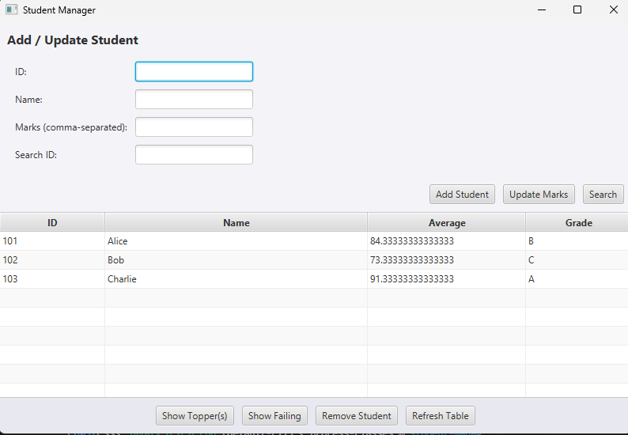

# Student Management App

A simple JavaFX-based student management application built with Maven.

## Overview

This project demonstrates a clean, object-oriented Java application with a JavaFX graphical user interface for managing student records.

It includes:
- a `Student` domain model that stores ID, name, and marks
- a `StudentManager` service that maintains student collections and provides operations like search, topper selection, failure detection, and mark updates
- a `Main` JavaFX application that allows users to add students, update marks, search by ID, view top performers, and list failing students in a table
- JUnit tests for core business logic in `StudentManager`

## Features

- Add new students with ID, name, and comma-separated marks
- Automatically clamp invalid marks to the valid range of `0–100`
- Compute student average score and letter grade
- Search students by ID
- Identify topper(s) based on highest average
- Display failing students below a configurable threshold
- Refreshable student table view
- Information and error dialogs for interaction feedback

## Project Structure

```
Student_Management/
├── pom.xml
├── README.md
├── .gitignore
├── gui-screenshot.png
├── src/main/java/
│   ├── Main.java
│   ├── Student.java
│   └── StudentManager.java
└── src/test/java/
    └── StudentManagerTest.java
```

## Screenshot



## Requirements

- Java 17 or newer
- Maven 3.8+
- Internet access for Maven dependency resolution

## Build and Run

### Compile

```powershell
cd d:\Student_Management
mvn compile
```

### Run tests

```powershell
cd d:\Student_Management
mvn test
```

### Launch the JavaFX GUI

```powershell
cd d:\Student_Management
mvn -U javafx:run
```

> The `-U` option forces Maven to update plugin metadata. This is useful when using JavaFX plugin version `0.0.8`.

## JavaFX notes

This project uses the OpenJFX Maven plugin to run the JavaFX application. The JavaFX dependencies configured in `pom.xml` are:

- `org.openjfx:javafx-controls`
- `org.openjfx:javafx-fxml`

The plugin configuration references `Main` as the application entry point.

## Development Notes

### Editing and refreshing dependencies

If your IDE shows red underlines for JavaFX or Maven dependencies, try:

- refreshing/reimporting the Maven project
- ensuring the IDE uses the same JDK version configured for Maven
- running `mvn compile` or `mvn test` from the terminal to validate the build environment

### Recommended workflow

1. Build and test locally
2. Run `mvn -U javafx:run` to launch the GUI
3. Commit changes and push to GitHub

## GitHub Repository

This project is packaged as a Maven application, making it easy to clone and run from any machine with Java and Maven installed.

## License

This repository does not include a license file by default. Add one if you want to publish it under a specific open-source license.
